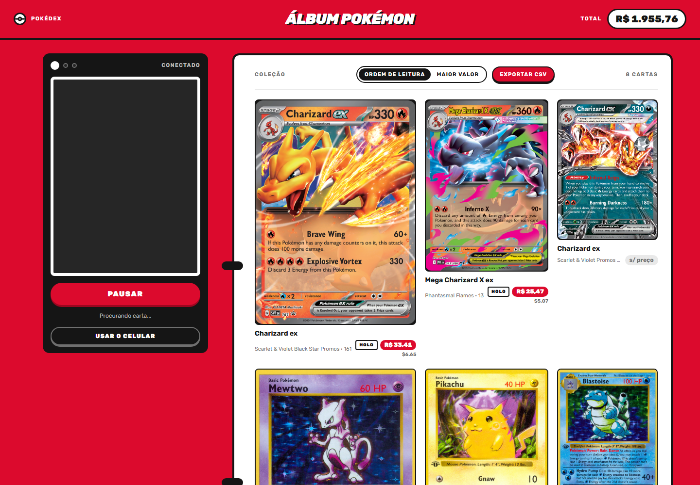
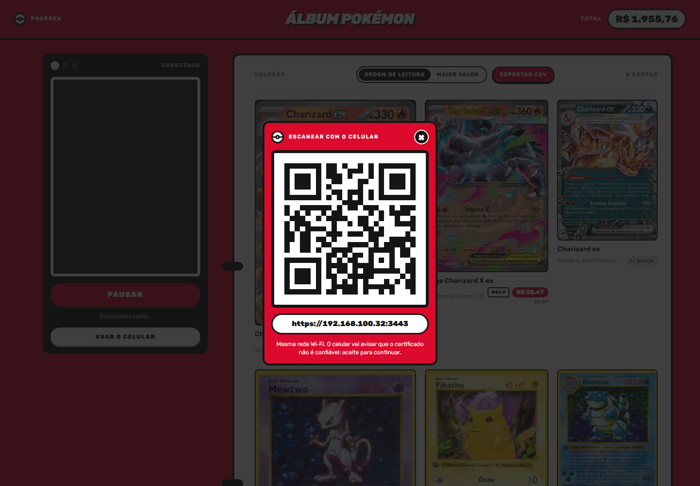
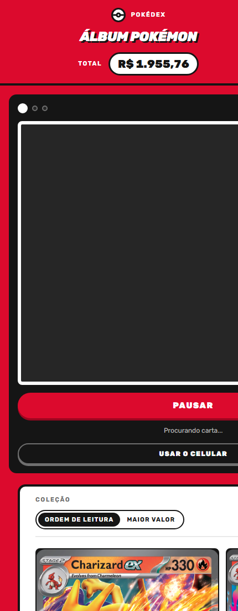

# Álbum Pokémon — scanner de cartas em tempo real

Aponte a câmera para uma carta Pokémon e ela entra no seu álbum com o valor de mercado, na hora.
Tudo roda **local e de graça**: a leitura da carta é feita por um modelo de visão no seu PC
(Qwen2.5‑VL via Ollama), e os preços vêm de APIs públicas sem cadastro.



## Como funciona

1. O navegador captura um frame da câmera a cada 2,5 s e envia pelo WebSocket.
2. O servidor pede ao **Qwen2.5‑VL** que *transcreva* o nome impresso no topo da carta e o número
   de coleção do rodapé (`013/094`). Ele lê texto, não adivinha pela arte.
3. O nome lido é validado contra a lista oficial de Pokémon (PokéAPI) — "Chamaleon" vira
   `Charmeleon`, "Bubbles" é descartado.
4. Ao detectar uma carta, a câmera **congela com a foto tirada** e um loading; o servidor relê essa
   foto em alta qualidade para confirmar.
5. Confirmada, a carta é buscada no **pokemontcg.io** pelo nome + número + tamanho do set, e o
   preço de mercado do TCGPlayer (USD) é convertido para **R$**. A carta "cola" no fichário e a
   câmera volta ao vivo.

## Destaques

- **Zero API paga** — visão local (Ollama), preços de APIs públicas gratuitas.
- **Leitura por OCR, não por semelhança** — resolve Charmander × Charmeleon × Charizard e cartas
  raras (Lokix, Audino…), em qualquer idioma com alfabeto latino.
- **Impressão exata** — o número de coleção e o total do set apontam a carta certa, não "outra
  Charizard"; variantes holo / reverse / normal têm preços diferentes e são distinguidas.
- **Celular como câmera** — QR code abre o scanner no seu telefone via HTTPS na rede local.
- **Álbum persistente** em SQLite: remover, ordenar por valor, exportar CSV.
- Visual Pokédex: vermelho, preto e branco, fichário de 9 bolsos.

## Requisitos

| Item | Detalhe |
|---|---|
| [Bun](https://bun.sh) ≥ 1.1 | runtime e gerenciador de pacotes |
| [Ollama](https://ollama.com) | servindo em `http://localhost:11434` |
| Modelo de visão | `ollama pull qwen2.5vl:7b` (~6 GB; GPU com 8 GB de VRAM dá ~1 s por leitura, CPU funciona mas é lento) |
| Câmera | webcam no PC **ou** celular na mesma rede Wi‑Fi |
| Internet | para preços e imagens das cartas |

> O `llama3.2-vision` não funciona bem aqui: além de problemas de arquitetura em algumas versões do
> Ollama, modelos LLaVA‑1.5 não leem texto e chutam pela arte. Use Qwen2.5‑VL (ou `qwen3-vl`,
> `minicpm-v` — configurável por `VISION_MODEL`).

## Instalação

```bash
git clone https://github.com/Gstxxx/pokemon-card-scanner.git
cd pokemon-card-scanner
bun install
ollama pull qwen2.5vl:7b
cp .env.example .env   # opcional, só se quiser mudar portas/modelo/API key
bun run dev
```

Abra `http://localhost:3002`. Permita a câmera e mostre uma carta: o scanner começa sozinho.

## Usando o celular

A câmera do celular lê as cartas muito melhor que a maioria das webcams. Como o navegador só libera
câmera em origem segura, o servidor também sobe em **HTTPS** quando existe um certificado em
`.certs/`:

```bash
bun run cert      # gera certificado autoassinado para localhost e os IPs da sua rede (uma vez)
bun run dev       # agora também em https://<ip-da-lan>:3443
```

No desktop, clique em **Usar o celular** (ou abra `/#celular`): aparece um QR com a URL HTTPS.



No celular: mesma rede Wi‑Fi, leia o QR, aceite o aviso do certificado autoassinado
(Chrome Android: *Avançado → Ir para o site*; Safari iOS: *Mostrar detalhes → visitar o site*) e
permita a câmera. A lente traseira é usada automaticamente e o layout se adapta:



Se o QR não abrir no celular, veja [Solução de problemas](#solução-de-problemas).

## Configuração

Variáveis de ambiente (arquivo `.env` na raiz, modelo em [`.env.example`](.env.example)):

| Variável | Padrão | Para quê |
|---|---|---|
| `PORT` | `3002` | porta HTTP |
| `PORT_HTTPS` | `3443` | porta HTTPS (só sobe se `.certs/` existir) |
| `OLLAMA_URL` | `http://localhost:11434` | onde o Ollama está servindo |
| `VISION_MODEL` | `qwen2.5vl:7b` | modelo de visão do Ollama |
| `POKEMONTCG_API_KEY` | — | chave gratuita de [dev.pokemontcg.io](https://dev.pokemontcg.io): limites maiores e menos erros 5xx |

## Scripts

| Comando | O que faz |
|---|---|
| `bun run dev` | servidor com reload automático |
| `bun run start` | servidor sem watch |
| `bun run cert` | gera `.certs/key.pem` e `cert.pem` (use `--force` se o IP mudar) |
| `bun run e2e` | bateria de 10 cartas reais contra o servidor em execução: acurácia de leitura, preço e falso positivo |

Resultado típico do `e2e`:

```
Name accuracy (case-insensitive exact): 10/10
Vision read matches expected (maybe):   10/10
Cards with market price:                10/10
No-card false positives:                0
Average seconds per card:               4.1
```

## Fontes de dados

| Dados | Fonte | Observação |
|---|---|---|
| Cartas, imagens e preços | [pokemontcg.io](https://pokemontcg.io) · [docs](https://docs.pokemontcg.io) | preços do TCGPlayer em USD (low/mid/high/market); sem chave há limite diário e instabilidade ocasional |
| Fallback de cartas e preços | [TCGdex](https://tcgdex.dev) · `api.tcgdex.net/v2/en/cards` | TCGPlayer (USD) e Cardmarket (EUR) |
| Nomes de Pokémon | [PokéAPI](https://pokeapi.co) | validação e correção do nome lido |
| Câmbio USD/EUR → BRL | [open.er-api.com](https://www.exchangerate-api.com/docs/free) | atualizado a cada hora, em cache |
| Leitura da carta | [Qwen2.5‑VL no Ollama](https://ollama.com/library/qwen2.5vl) | local, nenhum dado sai do seu PC |

Os preços são do mercado **americano**; não há API pública para preços da Liga Pokémon.

## Precisão e limites

- **Nome**: 10/10 na bateria de regressão e consistente ao vivo. Centralize a carta e preencha o
  visor — carta pequena ou inclinada vira "procurando carta…".
- **Impressão**: número + total do set resolvem a carta exata na grande maioria dos casos; cartas
  promocionais sem número impresso caem no melhor candidato pelo nome.
- **Acabamento** (holo/reverse/normal): a detecção pelo modelo é a parte menos confiável — em
  cartas foscas ele às vezes marca holo. O preço mostra a variante usada (`HOLO`, `REV`, `NORMAL`).
- **Preço**: depende de APIs externas. Há retry com backoff, timeout de 8 s por chamada, fila
  sequencial e fallback para TCGdex; ainda assim uma carta pode aparecer como "s/ preço".
- **Desempenho**: ~1 s por leitura com GPU; a confirmação com preço leva 3–6 s no total.

## Estrutura

```
src/
  server.ts            Bun.serve + Hono: WebSocket (/ws), API do álbum, HTTPS, QR
  services/
    vision.ts          prompt de transcrição e parsing da resposta do Qwen2.5-VL
    pokedex.ts         lista de nomes (PokéAPI) e fuzzy match
    pricing.ts         pokemontcg.io (+ TCGdex) com ranking por nome, número, set e variante
    fx.ts              câmbio USD/EUR → BRL
    upscale.ts         pré-processamento da foto e detecção de frame vazio
    album.ts           SQLite (bun:sqlite): coleção persistente e CSV
  public/
    index.html, style.css, app.js   front sem build: câmera, WebSocket, fichário, QR
scripts/
  e2e.ts               regressão com 10 cartas reais
  gen-cert.ts          certificado autoassinado para HTTPS na LAN
docs/
  API.md               protocolo WebSocket e rotas REST
  ARQUITETURA.md       decisões de projeto e o que não funcionou
```

## Solução de problemas

| Sintoma | Causa provável | O que fazer |
|---|---|---|
| "Desconectado" no topo | servidor fora do ar ou porta diferente | veja a URL impressa pelo `bun run dev` |
| "Procurando carta…" eterno | carta pequena/inclinada, ou Ollama sem o modelo | preencha o visor; `ollama list` deve mostrar `qwen2.5vl:7b` |
| Lê sempre "nenhuma carta" | Ollama parado | `ollama serve` (ou abra o app do Ollama) |
| "s/ preço" | pokemontcg.io instável ou carta sem preço no TCGPlayer | tente de novo; configure `POKEMONTCG_API_KEY` |
| QR não abre no celular | redes diferentes, URL sem `https://`, firewall | mesmo Wi‑Fi (sem dados móveis); teste `http://<ip>:3002` primeiro; libere `bun.exe` no firewall |
| Porta 3000/3002 ocupada | outro serviço | `PORT=3005 bun run dev` |
| Câmera espelhada ou errada | — | o app não espelha; em notebooks com várias câmeras, troque no navegador |

## Documentação

- [docs/API.md](docs/API.md) — mensagens do WebSocket e rotas REST do álbum
- [docs/ARQUITETURA.md](docs/ARQUITETURA.md) — pipeline, decisões e experimentos descartados

## Licença

[MIT](LICENSE). Pokémon e Pokémon TCG são marcas da Nintendo / Creatures / GAME FREAK; este projeto
não tem afiliação e usa apenas dados públicos.
